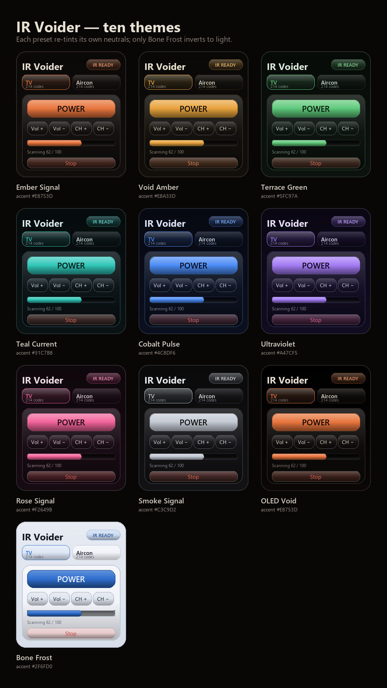

# IR Voider

<p align="center">
  
</p>

IR Voider turns an **Android phone with a built-in IR blaster** into a clean,
offline universal remote. No ads, no account, no tracking — just the phone's
IR LED.

**[Download the latest APK](https://github.com/saintedKyle/ir-voider/releases/latest)** ·
[Phone compatibility](PHONE_COMPATIBILITY.md) · [Privacy](PRIVACY.md)

## Install on your phone

1. Download the latest APK from [Releases](https://github.com/saintedKyle/ir-voider/releases/latest).
2. Open it on the phone. Android asks to allow installs from your browser or file
   manager — allow it.
3. Install **IR Voider** and open it.

Requires **Android 6.0+** and a **built-in IR emitter**. It does not work on
iPhones, iPads, tablets, TVs, PCs, or phones without IR hardware. On MIUI/HyperOS:
**Settings → Apps → Special access → Install unknown apps**.

The APK is sideloaded, so Android may show a warning. Only install builds from
this repository's Releases.

> Upgrading from an earlier v1.4 APK? 1.5 installs straight over it and keeps your
> saved devices. Only the original debug-signed build has to be uninstalled first —
> Android blocks in-place updates when the signing key changes.

## Use

1. Tap **≡ More** (top-left) and pick a category: TV, air conditioner, projector,
   fan, LED light, soundbar, and more.
2. Pick your brand and model, then press **POWER**.
3. No reaction? Tap **Find code**. It sends one power code at a time; when the
   device reacts, tap **It worked**. **Previous** replays the last code.
4. Save and name the remote with **⚙** (top-right).

## What it does

- **39 categories · 1,502 remotes · 17,789 IR codes** from Flipper-IRDB, bundled offline.
- TVs, ACs, projectors, fans, LED lights, soundbars, audio receivers, streaming
  and cable boxes, DVD/Blu-ray players, cameras, air purifiers, and more.
- Device-specific buttons on swipeable pages: Basics, Navigation, Media, Numbers,
  Colors and Extras. Power stays pinned above the pages.
- Searchable brands; scanner with **Last 5** history, Previous/Pause/Stop, and a
  confirmation before an all-brand scan.
- Saved devices with custom names, IR boost / **Force mode**, diagnostics.
- **Ten themes** (orange, gold, green, teal, blue, violet, rose, silver, black, light)
  — pick one under **≡ More → Appearance**.
- Air-conditioner temperature, mode, fan and swing where the profile supports it.
- Import raw `.ir` captures as learned remotes.
- **IR override** for phones that report NO IR despite having an emitter.
- **DIY jack blaster** — send IR out of the 3.5mm port. The app plays a 19 kHz tone
  and a pair of IR LEDs wired back-to-back turns it into 38 kHz of light, because a
  48 kHz audio output cannot produce 38 kHz itself. Set up under **≡ More → Jack
  blaster**. Needs two LEDs and a 47–100 Ω resistor; range is about 1–2 m.
- **Scan clock** — elapsed time and an estimate of what is left, paused correctly
  when you pause, with the screen held awake for the whole run.
- **Optional update check** — the only network code in the app. It asks GitHub for
  the newest release once per app open and is one tap away in **≡ More → Updates**.
  Everything else, including every remote and scan, works in airplane mode.

Air conditioners include the buttons captured in the database. Raw AC frames can
represent a fixed state rather than an incremental step. If your model is missing,
its protocol is not in the database; a raw `.ir` capture can add your own buttons.

## Look

Nothing in the app is a flat fill. Buttons, cards, chips, the scanner track and
the bottom sheet are shaded plates — lit top rim, body gradient, contact shadow —
drawn in code, and they sink under a press.

Ten themes re-colour all of it, and each brings its own neutrals, so a blue accent
sits on blue-black surfaces instead of a warm card with a cold button: **Ember
Signal** (orange), **Void Amber** (gold), **Terrace Green**, **Teal Current**,
**Cobalt Pulse**, **Ultraviolet**, **Rose Signal**, **Smoke Signal** (silver),
**OLED Void** (true black for AMOLED) and **Bone Frost** — the light one, for
daylight. The layout, type and control positions never change.

**≡ More → Appearance** switches themes instantly. Saved devices, IR settings and
scanner history are untouched, and the choice is remembered on the phone.

<p align="center">
  
</p>

## How IR works — and the limits

The phone's IR LED blinks invisible light in a precise pattern; a receiver in the
device reads the pulses. IR is **one-way and line-of-sight**:

- the phone cannot detect, identify, or automatically control nearby devices;
- IR does not pass through walls;
- RF and Bluetooth devices are not supported;
- some air conditioners need the exact model protocol.

Only scan devices you own or have permission to control.

## Phones

See **[PHONE_COMPATIBILITY.md](PHONE_COMPATIBILITY.md)** for the **535-listing IR
phone list**, the confirmed model, historical IR phones that cannot run the app,
and a 10-second check. It is a public-data snapshot, not a guarantee — same-name
phones can ship with or without IR by region. IR blasters are not part of
Android's requirements, so the app asks the hardware and shows **IR READY** (an
emitter the OS reports), **JACK BLASTER** (jack sending is on and the port reports a
plug) or **NO IR**. No label can prove light left an LED, because a phone has no IR
receiver to look for it — the jack screen reports where the sound was *measured* going
instead, which is the closest thing to a real check.

## Privacy

No account, analytics, ads, or network access. The only permission is
`TRANSMIT_IR`. See [PRIVACY.md](PRIVACY.md) or the hosted policy:
https://saintedkyle.github.io/ir-voider/privacy.html

## Build from source

Requirements: JDK 17+, Android SDK Platform 36, Build-Tools 36.0.0.

```bash
./gradlew assembleDebug
```

APK: `app/build/outputs/apk/debug/app-debug.apk`.

The IR database can be regenerated with `python tools/build_db.py` after
downloading [Flipper-IRDB](https://github.com/Lucaslhm/Flipper-IRDB) into
`data/irdb_all/`. The README artwork comes from `python
tools/make_readme_images.py` and `python tools/make_theme_sheet.py`, which redraw
the same shading maths in Pillow.

## License, forks and contributions

**License:** [GPL-3.0-or-later](LICENSE). Copyright and credits are in
[NOTICE](NOTICE) and [THIRD_PARTY_NOTICES.md](THIRD_PARTY_NOTICES.md).

**Forking:** the GPL permits forks, and GitHub does not allow disabling forks on
a public repository — a public open-source repo is forkable by design. The
maintainer does not support or endorse modified builds. The **IR Voider** name
and logo are not licensed for forks or redistributed builds.

**Contributions:** this is a personal project; external contributions and pull
requests are not accepted.

## Preview

<p align="center">
  
</p>

<p align="center"><em>Illustrative v1.5 UI preview — shaded plates, not flat fills. Buttons depend on the selected remote profile; pages are swipeable.</em></p>

## Docs

- [PHONE_COMPATIBILITY.md](PHONE_COMPATIBILITY.md) — which phones work
- [PRIVACY.md](PRIVACY.md) — no data collection
- [TERMS.md](TERMS.md) — terms of use
- [SECURITY.md](SECURITY.md) — reporting a vulnerability
- [THIRD_PARTY_NOTICES.md](THIRD_PARTY_NOTICES.md) — code and data credits

See [Releases](https://github.com/saintedKyle/ir-voider/releases) for version history.

---

Made by **poging kyle**.
