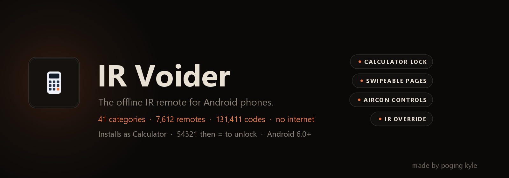
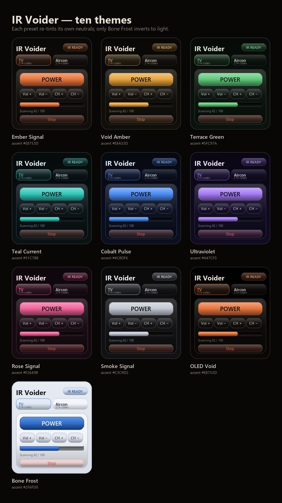
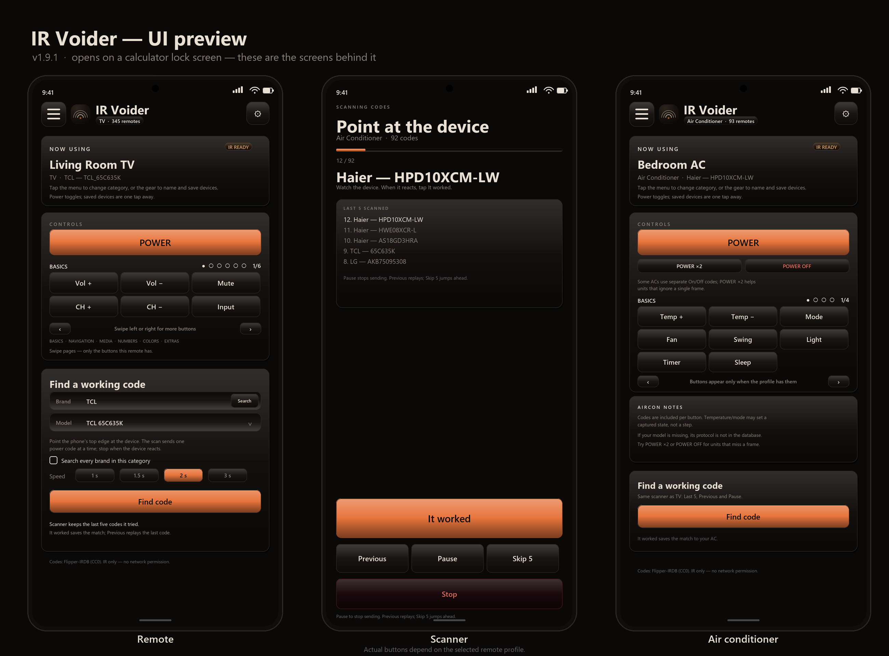

# IR Voider

<p align="center">
  
</p>

IR Voider turns an **Android phone with an IR blaster** — built-in, or two LEDs you
soldered onto the 3.5 mm jack — into a clean,
offline universal remote. No ads, no account, no tracking — just the phone's
IR LED.

**[Download the latest APK](https://github.com/saintedKyle/ir-voider/releases/latest)** ·
[Phone compatibility](PHONE_COMPATIBILITY.md) · [Privacy](PRIVACY.md)

## Install on your phone

1. Download the latest APK from [Releases](https://github.com/saintedKyle/ir-voider/releases/latest).
2. Open it on the phone. Android asks to allow installs from your browser or file
   manager — allow it.
3. Install **IR Voider** and open it.

Requires **Android 6.0+** and an IR emitter: either the phone's **built-in blaster**
or a **DIY two-LED blaster on the 3.5 mm headset jack** (see the jack-blaster bullet
below). It does not work on iPhones, iPads, tablets, TVs, PCs, or phones that have
neither. On MIUI/HyperOS:
**Settings → Apps → Special access → Install unknown apps**.

The APK is sideloaded, so Android may show a warning. Only install builds from
this repository's Releases.

> Upgrading from an earlier v1.4 APK? 1.5 installs straight over it and keeps your
> saved devices. Only a build signed with a different key has to be uninstalled
> first — Android blocks in-place updates when the signing key changes.
>
> **1.7.0 (versionCode 25) is release-signed** with a new `CN=IR Voider` key
> generated for this release. It installs over itself and future builds signed with
> the same key, keeping saved remotes, macros, themes and settings. Because the
> original 1.6.5 key is gone, this one-time move needs an uninstall first if your
> phone has **1.6.5 or an earlier debug-signed 1.7.0 build**. That clears saved
> remotes and macros because backups are off. After this install, updates work
> normally again.

## What's new in 1.7

- **Macros, restored and unlocked.** A macro is a named list of buttons with a pause
  after each press. Run it once, loop it a fixed number of times, or tap **Loop ∞**
  to repeat it until **Stop macro**. Steps can be reordered, re-timed and built from
  every key the remote carries — including keys added from sibling profiles.
- **Test Storm.** Fires a shuffled deck of every button on the remote, pass after
  pass, so you can watch which keys the device answers. Speed chips go down to
  150 ms. **STOP STORM** lands within 50 ms. Power is left out unless you tick the
  box, and aircon frames are allowed to finish before the next press.
- **Shortcuts row.** Netflix, YouTube, Prime, Apps, Copilot and Web sit under the
  power buttons. **Prime, Copilot and Web always open in Chrome on the phone** —
  IR cannot carry a URL to a TV. Netflix, YouTube and Apps still send the real IR
  key when the profile has one; otherwise Netflix and YouTube fall back to Chrome.
  Hold **Web** to change its address. A tinted chip therefore means a tap sends IR,
  and untinted chips open on the phone.
- **A retro boot screen while the IR database loads.** Amber CRT type, scanlines, a
  sweeping cathode beam, rotating boot lines and a progress bar that races to 94 %
  before the real database is ready. The full bar and **READY.** stay up briefly.
- **A shorter, grouped More screen.** Categories, tools and app settings are now
  compact two-column tiles. Choosing a device type or a theme opens its own picker
  instead of stretching the main sheet with 40 category chips and 10 theme cells.
- **TV shutdown sound.** In **More → Shutdown sound**, flip the switch and paste a
  direct `https://` audio link (`.mp3`, `.m4a`, `.ogg`, `.wav`). The clip plays on
  the phone, then the TV's Power Off code is sent. If the profile only has one Power
  toggle, the clip plays on that tap too, because one-way IR cannot tell on from off.
  A slow or broken link never blocks the IR — a watchdog sends it anyway. **Test
  sound** previews the clip without touching the TV.
- **AirMax and Beko aircon temperature, mode and fan.** Their captures are Midea
  **R05D** state frames, which encode temperature in a Gray code and mode/fan in the
  same 48-bit packet. 1.6.x only exposed the one captured 17 °C frame, so Off could
  look like "lower the temperature". 1.7 rebuilds real 17–30 °C, Cool/Dry/Fan/Heat/
  Auto and fan-speed frames from the unit's own captured header and timing. They
  live under **AIRCON SET** on the swipe pages.
- **Power Doctor.** For an aircon whose Off code only changes temperature, it walks
  through the current Off (one, two and three frames), the On frame, then Off/On
  codes from sibling profiles — same brand first. When the unit actually stops, tap
  **This turned it off — save** and that code becomes this remote's POWER OFF.
- **Signal Lab.** IR is one-way, so the phone cannot hear a device answer. Signal Lab
  sends one button at a carrier, frame count and gap you choose; when a combination
  works, save it per remote. Saved timing is used by the pad, macros and Test Storm.
  The app also snaps every carrier to a range the phone reports it can emit.
- **Add a missing button.** Copies a real captured key from another profile in the
  same category, saves it as a patch, and merges it into the live remote and macro
  picker. Added keys are listed separately so **Remove added buttons** can undo them.
- **No more silently dropped buttons.** 1.7 loads every key in every profile instead
  of a fixed list, and keeps profiles that have buttons but no power code. Anything
  new lands on an **EXTRAS** page rather than disappearing.
- **Brand colour and vibe.** The controls header, page titles, power plate and
  shortcut chips pick up a muted brand tint — LG amber-red, TCL red, Samsung blue,
  Sony blue, Hisense green, Haier blue and so on — blended with the active theme so
  contrast stays inside the palette. Layout, type and control positions do not move.
- **Tested reach over hype.** Test Storm and Signal Lab exist because no app can
  truthfully promise 100 % IR. They let you find the frame timing and keys that work
  on *your* unit instead of guessing.


## Use

1. Tap **≡ More**, then **Device type**, and pick a category: TV, air conditioner,
   projector, fan, LED light, soundbar, and more.
2. Pick your brand and model — or tap **Search** next to either row and type, e.g.
   `HWE08`, to jump straight to that profile. Then press **POWER**.
3. No reaction? Tap **Find code**. It sends one power code at a time; when the
   device reacts, tap **It worked**. **Previous** replays the last code.
4. Save and name the remote with **⚙** (top-right).
5. Use the **SHORTCUTS** row for Netflix, YouTube, Prime, Apps, Copilot and Web, or
   **MACROS** in the controls header to build a sequence. **TEST** starts Test Storm.
   Prime, Copilot and Web open in Chrome; Netflix, YouTube and Apps try the TV first.

## What it does

- **40 categories · 2,050 brands · 5,666 remotes · 90,054 IR codes** from Flipper-IRDB,
  bundled offline.
- TVs, ACs, projectors, fans, LED lights, soundbars, audio receivers, streaming
  and cable boxes, DVD/Blu-ray players, cameras, air purifiers, and more.
- Device-specific buttons on swipeable pages: Basics, Navigation, Media, Apps,
  Numbers, Colors, a Keyboard page when the profile has letter keys, an **Aircon
  Set** page on supported aircon protocols, and Extras. Basics are ordered per
  device type, pairs such as volume and channel stay side by side, the D-pad keeps
  its cross layout, numbers form a 3×4 pad, colours sit in one row, and two-button
  rows fill the width. Power stays pinned above the pages.
- **One tap sends exactly one code.** Volume, channel, temperature and everything
  else fire once, the way a press on the original remote does.
- **Hold any button to keep sending it** — release stops. Power is the exception:
  holding a toggle would strobe the device on and off, so it stays one press.
- **Type to the device.** A **Type to TV** button opens the phone keyboard and sends
  each character as one IR key press — digits, dash and dot on a normal media
  remote, plus letters on any profile that carries letter keys. TVs type letters
  through their on-screen keyboard; IR has no universal text protocol, so the panel
  says which characters this profile can actually send and skips the rest.
- **Type to search brands and models** on the *Find a working code* card. One field
  filters every profile in the category, so `HWE08` or `AS18` finds the aircon
  without scrolling a spinner.
- **Explicit aircon On and Off.** A profile that captured both directions shows
  **POWER ON** and **POWER OFF** instead of one guessing toggle, and **POWER ×2**
  re-sends with a real gap for units that ignore a single frame. **Power Doctor**
  fixes a unit whose Off frame only changes temperature. Every other device type
  now shows **POWER OFF** too — 1,044 remotes carried an Off code the old interface
  never displayed.
- Searchable brands; scanner with **Last 5** history, Previous/Pause/Stop, and a
  confirmation before an all-brand scan.
- **Scan speed down to 0.2 s** per code — the **Speed** row on the *Find a working
  code* card, 10× faster than the old 2 s default and 2.5× faster than 1.6.3. The
  scanner now starts the next code when the previous frame has actually finished,
  not on a blind timer, so fast scanning never truncates a code. A **Range** row
  limits an all-brand scan to brand initials, e.g. **F–R**, so you can skip the
  brands you have already ruled out.
- **Honest provenance.** Codes that come from community dumps rather than this app's
  own bench runs are labelled **untested source** in the scanner and in the About
  panel. Nothing is claimed to work that has not been seen to work.
- Saved devices with custom names, opt-in **IR boost** / **Force mode**, diagnostics.
- **Ten themes** (orange, gold, green, teal, blue, violet, rose, silver, black, light)
  — pick one under **≡ More → Appearance**.
- Air-conditioner temperature, mode, fan and swing where the profile supports it.
- Import raw `.ir` captures as learned remotes.
- **IR override** for phones that report NO IR despite having an emitter.
- **DIY jack blaster** — send IR out of the 3.5mm port. The app plays a 19 kHz tone
  and a pair of IR LEDs wired back-to-back turns it into 38 kHz of light, because a
  48 kHz audio output cannot produce 38 kHz itself. Set up under **≡ More → Jack
  blaster**. Needs two LEDs and a 47–100 Ω resistor; range is about 1–2 m.
- **Scan clock** — elapsed time and an estimate of what is left, paused correctly
  when you pause, with the screen held awake for the whole run.
- **Optional update check** — the only network code in the app. It asks GitHub for
  the newest release once per app open and is one tap away in **≡ More → Updates**.
  Everything else, including every remote and scan, works in airplane mode.
- **Optional TV shutdown sound** — play a direct audio link on the phone just before
  the TV's Power Off code. Set it in **≡ More → Shutdown sound**; it is off by
  default, and a failed or slow link never stops the IR.

Air conditioners include the buttons captured in the database. Raw AC frames can
represent a fixed state rather than an incremental step, and a captured power code
may be one-directional — that is why profiles with both an On and an Off capture
show two separate buttons. AirMax and Beko are Midea R05D units: 1.7 generates
their missing temperature, mode and fan frames from the captured state packet, so
the **Aircon Set** page sets an absolute target from 17–30 °C. For any other model
whose protocol is missing, **Add a missing button** can pull a key from a sibling
profile, or a raw `.ir` capture can add your own buttons.

## Look

Nothing in the app is a flat fill. Buttons, cards, chips, the scanner track and
the bottom sheet are shaded plates — lit top rim, body gradient, contact shadow —
drawn in code, and they sink under a press.

Ten themes re-colour all of it, and each brings its own neutrals, so a blue accent
sits on blue-black surfaces instead of a warm card with a cold button: **Ember
Signal** (orange), **Void Amber** (gold), **Terrace Green**, **Teal Current**,
**Cobalt Pulse**, **Ultraviolet**, **Rose Signal**, **Smoke Signal** (silver),
**OLED Void** (true black for AMOLED) and **Bone Frost** — the light one, for
daylight. The layout, type and control positions never change.

1.7 adds a second, quieter layer: the controls header, page titles, power plate and
shortcut chips take a muted tint from the selected brand — LG amber, TCL red,
Samsung blue, Sony blue, Hisense green, Haier blue, AirMax cyan — mixed with the
active theme so every theme keeps its own contrast. It is a tint, not a new layout.

**≡ More → Appearance** switches themes instantly. Saved devices, IR settings and
scanner history are untouched, and the choice is remembered on the phone.

<p align="center">
  
</p>

## How IR works — and the limits

The phone's IR LED blinks invisible light in a precise pattern; a receiver in the
device reads the pulses. IR is **one-way and line-of-sight**:

- the phone cannot detect, identify, or automatically control nearby devices;
- IR does not pass through walls;
- RF and Bluetooth devices are not supported;
- some air conditioners need the exact model protocol.

Only scan devices you own or have permission to control.

## Phones

See **[PHONE_COMPATIBILITY.md](PHONE_COMPATIBILITY.md)** for the **535-listing IR
phone list**, the confirmed model, historical IR phones that cannot run the app,
and a 10-second check. It is a public-data snapshot, not a guarantee — same-name
phones can ship with or without IR by region. IR blasters are not part of
Android's requirements, so the app asks the hardware and shows **IR READY** (an
emitter the OS reports), **JACK BLASTER** (jack sending is on and the port reports a
plug) or **NO IR**. No label can prove light left an LED, because a phone has no IR
receiver to look for it — the jack screen reports where the sound was *measured* going
instead, which is the closest thing to a real check.

## Privacy

No account, analytics, ads, or tracking. `TRANSMIT_IR` is the only permission the
remote uses; `INTERNET` and `ACCESS_NETWORK_STATE` exist only for the optional
GitHub update check. See [PRIVACY.md](PRIVACY.md) or the hosted policy:
https://saintedkyle.github.io/ir-voider/privacy.html

## Build from source

Requirements: JDK 17+, Android SDK Platform 36, Build-Tools 36.0.0.

```bash
./gradlew assembleDebug
```

APK: `app/build/outputs/apk/debug/app-debug.apk`.

The IR database can be regenerated with `python tools/build_db.py` after
downloading [Flipper-IRDB](https://github.com/Lucaslhm/Flipper-IRDB) into
`data/irdb_all/`. It reads both the top-level captures and the `_Converted_/`
dumps, drops anything Android cannot transmit, and writes `assets/remotes.json`
(the index) plus one `assets/db/<category>.json` shard per category, which the
app loads on demand. The README artwork comes from `python
tools/make_readme_images.py` and `python tools/make_theme_sheet.py`, which redraw
the same shading maths in Pillow.

## License, forks and contributions

**License:** [GPL-3.0-or-later](LICENSE). Copyright and credits are in
[NOTICE](NOTICE) and [THIRD_PARTY_NOTICES.md](THIRD_PARTY_NOTICES.md).

**Forking:** the GPL permits forks, and GitHub does not allow disabling forks on
a public repository — a public open-source repo is forkable by design. The
maintainer does not support or endorse modified builds. The **IR Voider** name
and logo are not licensed for forks or redistributed builds.

**Contributions:** this is a personal project; external contributions and pull
requests are not accepted.

## Preview

<p align="center">
  
</p>

<p align="center"><em>Illustrative UI preview — shaded plates, not flat fills. The layout, type and control positions are unchanged in 1.7; buttons depend on the selected remote profile, and pages are swipeable.</em></p>

## Docs

- [PHONE_COMPATIBILITY.md](PHONE_COMPATIBILITY.md) — which phones work
- [PRIVACY.md](PRIVACY.md) — no data collection
- [TERMS.md](TERMS.md) — terms of use
- [SECURITY.md](SECURITY.md) — reporting a vulnerability
- [THIRD_PARTY_NOTICES.md](THIRD_PARTY_NOTICES.md) — code and data credits

See [Releases](https://github.com/saintedKyle/ir-voider/releases) for version history.

---

Made by **poging kyle**.
