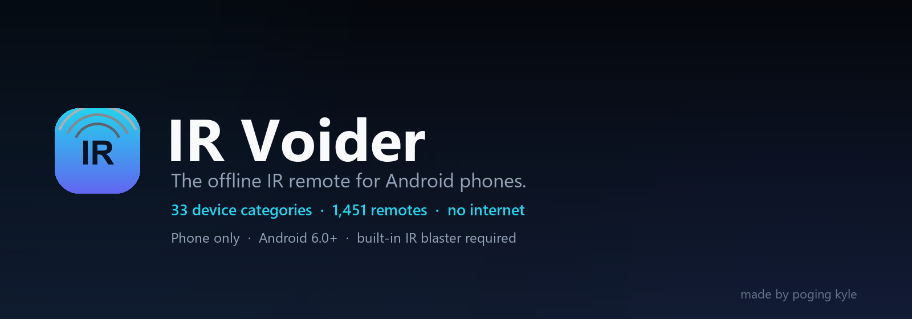
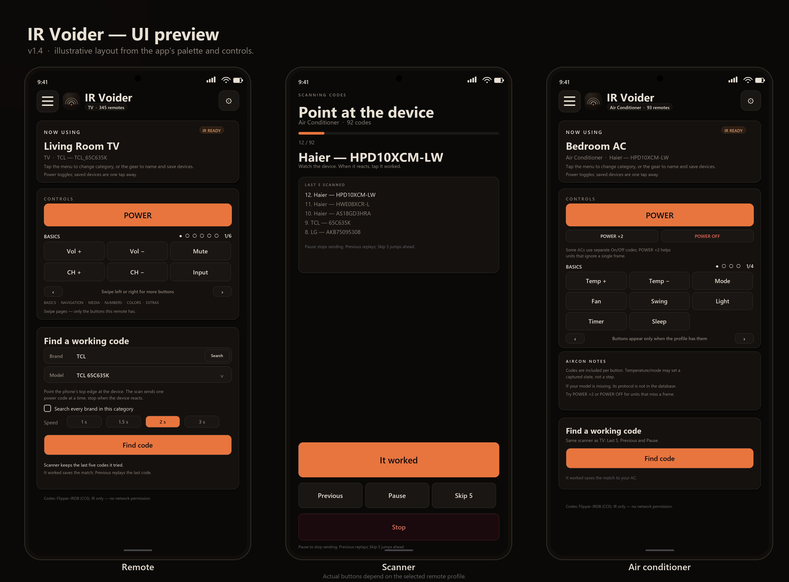
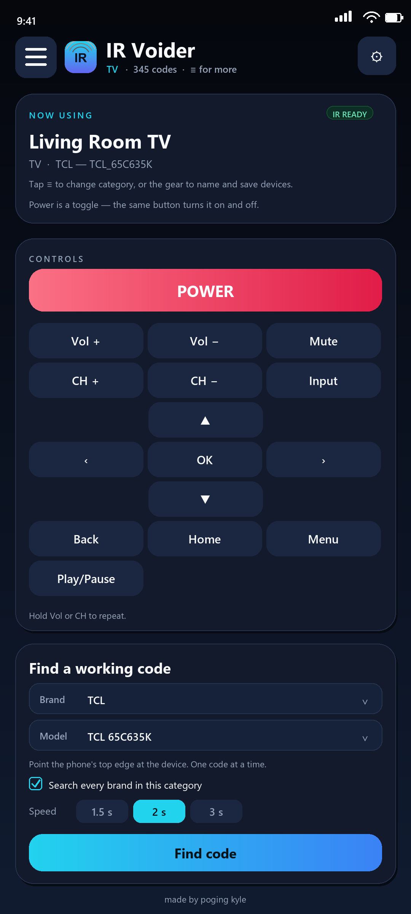
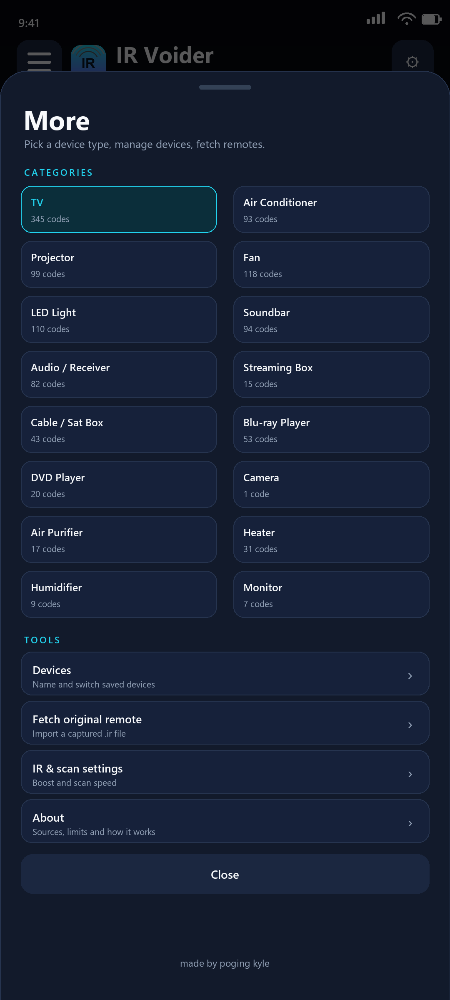
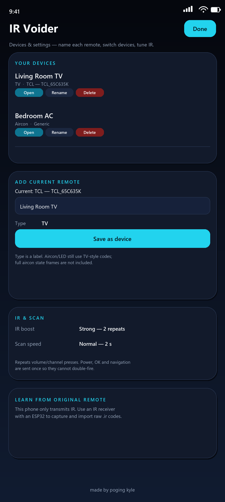

# IR Voider

  

A clean, offline IR remote for **Android phones with an IR blaster**. No ads, no
account, no internet permission — just your phone's IR LED.

**Download:** [IRVoider-1.0.apk](dist/IRVoider-1.0.apk) · **Phones:** [compatibility](PHONE_COMPATIBILITY.md) · **How it works:** [HOW_IT_WORKS.md](HOW_IT_WORKS.md) · **Google Play:** [release guide](PLAY_STORE.md) (pending)

## Install on your phone

1. Download `IRVoider-1.0.apk` to the phone (browser, USB, or cloud drive).
2. Tap the APK. Android asks to allow installs from this source — allow it.
3. Install **IR Voider** and open it.

On MIUI/HyperOS: **Settings → Apps → Special access → Install unknown apps** and
allow your browser/file manager if the prompt does not appear.

The app needs **Android 6.0 or newer** and a built-in IR blaster. It does not work
on iPhones, iPads, tablets, TVs, PCs, or phones without an IR emitter.

> This is a sideload APK signed with a debug key, not a Google Play release.
> Android may show a warning; choose **Install anyway**.

## Use

1. Tap **≡ More** (top-left) and pick a device category: TV, Air Conditioner,
   Projector, Fan, LED Light, Soundbar, and more.
2. Pick your brand and model. Press **POWER**.
3. No reaction? Tap **Find code**. It sends one power code at a time; when the
   device reacts, tap **It worked**. Missed it? **Previous** replays the last code.
4. Name and save devices with the **⚙** button (top-right).

## What it does

- **33 categories · 1,451 remotes · 16,841 IR codes** from Flipper-IRDB.
- Dynamic buttons per device with **swipeable pages** (Basics, Navigation, Media,
  Numbers, Colors, Extras). Power stays pinned above the pages.
- Expanded keys: digits, color buttons, info/guide, media transport, subtitle,
  audio, aspect and more.
- Auto-find with duplicate removal and "previous code" rewind.
- Saved devices with custom names and types.
- IR boost for volume/channel/temperature, plus **Boost all** for every button
  except POWER.
- Import raw `.ir` captures as "Learned" remotes.
- **No internet permission.** Works in airplane mode.

Air conditioners in the built-in database expose **Power only**; full-state
temperature/mode frames need a separate encoder set. A raw `.ir` capture can add
more buttons for your own AC.

## Preview

  

<em>Illustrative UI preview of v1.0, generated from the app's layout and palette.</em>

Individual screens

  
  
  

## Phones

See **[PHONE_COMPATIBILITY.md](PHONE_COMPATIBILITY.md)** for confirmed and
commonly reported IR phones, models that do **not** work, and how to check your
phone in 10 seconds. A complete model list is impossible; the app checks the IR
hardware at runtime and shows **IR READY** or **NO IR**.

## Privacy

No account, no analytics, no ads, no network access. The only permission is
`TRANSMIT_IR`. See [PRIVACY.md](PRIVACY.md) or the hosted policy:
https://saintedkyle.github.io/ir-voider/privacy.html

## License, forks and contributions

**License:** [GPL-3.0-or-later](LICENSE). The app is free and open source.

**Forking:** the GPL permits forks, and GitHub does not allow disabling forks on
a public repository — a public open-source repo is forkable by design. The
maintainer does not support or endorse modified builds. The **IR Voider** name
and logo are not licensed for forks or redistributed builds.

**Contributions:** this is a personal project and external contributions are not
accepted. Please do not open pull requests. See [CONTRIBUTING.md](CONTRIBUTING.md).

## Docs

- [PHONE_COMPATIBILITY.md](PHONE_COMPATIBILITY.md) — which phones work
- [HOW_IT_WORKS.md](HOW_IT_WORKS.md) — IR, scanning, limits
- [PRIVACY.md](PRIVACY.md) — no data collection
- [TERMS.md](TERMS.md) — terms of use
- [SECURITY.md](SECURITY.md) — reporting a vulnerability
- [THIRD_PARTY_NOTICES.md](THIRD_PARTY_NOTICES.md) — code/data credits
- [BUILDING.md](BUILDING.md) — build from source
- [CHANGELOG.md](CHANGELOG.md)
- [PLAY_STORE.md](PLAY_STORE.md) — Google Play release guide

---

Made by **poging kyle**.
